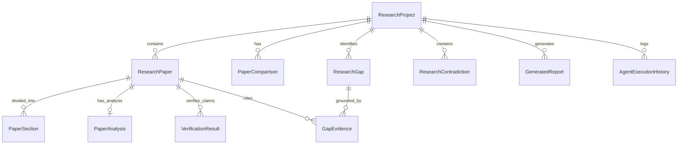

# Literature Intelligence Platform — Database Schema Documentation

## Overview

The platform uses a hybrid dual-store database architecture:
1. **SQLite (`backend/data/literature.db`):** Relational store for structured entities, project metadata, analysis outputs, gaps, contradictions, verifications, and audit histories. Configured in **WAL (Write-Ahead Logging)** mode.
2. **ChromaDB (`backend/data/chromadb/`):** Persistent vector store managing 768-dimensional document chunk embeddings with Cosine distance indexing.

---

## 1. SQLite Relational Schema (`literature.db`)



---

### Table: `research_projects`
Represents user research projects and domain workspaces.

| Column | Type | Constraints | Description |
|:---|:---|:---|:---|
| `id` | VARCHAR(36) | PRIMARY KEY | UUID string identifier |
| `title` | VARCHAR(255) | NOT NULL | Project title |
| `domain` | VARCHAR(255) | NOT NULL | Research field / topic |
| `description` | TEXT | NULLABLE | Detailed project objectives |
| `created_at` | DATETIME | DEFAULT utcnow | Timestamp of creation |
| `updated_at` | DATETIME | DEFAULT utcnow | Timestamp of last update |

---

### Table: `research_papers`
Academic research papers ingested into the platform.

| Column | Type | Constraints | Description |
|:---|:---|:---|:---|
| `id` | VARCHAR(36) | PRIMARY KEY | UUID string identifier |
| `project_id` | VARCHAR(36) | FOREIGN KEY -> `research_projects.id` | Associated research project |
| `title` | VARCHAR(500) | NOT NULL, INDEXED | Extracted academic paper title |
| `authors` | TEXT | NULLABLE | Comma-separated or JSON string of authors |
| `abstract` | TEXT | NULLABLE | Paper abstract text |
| `publication_year`| INTEGER | NULLABLE, INDEXED | Year of publication |
| `doi` | VARCHAR(100) | NULLABLE | Digital Object Identifier |
| `venue` | VARCHAR(255) | NULLABLE | Conference or journal venue |
| `file_path` | VARCHAR(500) | NOT NULL | Relative path to local stored PDF |
| `file_size_bytes` | INTEGER | NOT NULL | File size in bytes |
| `total_pages` | INTEGER | NOT NULL | Total page count |
| `processing_status`| VARCHAR(50) | DEFAULT 'pending' | Status: `pending`, `processing`, `completed`, `failed` |
| `created_at` | DATETIME | DEFAULT utcnow | Upload timestamp |
| `updated_at` | DATETIME | DEFAULT utcnow | Last modified timestamp |

---

### Table: `paper_sections`
Text passages and structural sections extracted from papers with 1-indexed page citations.

| Column | Type | Constraints | Description |
|:---|:---|:---|:---|
| `id` | VARCHAR(36) | PRIMARY KEY | UUID string identifier |
| `paper_id` | VARCHAR(36) | FOREIGN KEY -> `research_papers.id` | Parent paper reference |
| `section_title` | VARCHAR(255) | NOT NULL | Section heading (e.g. "Methodology") |
| `content` | TEXT | NOT NULL | Verbatim text content of chunk |
| `page_number` | INTEGER | NOT NULL, INDEXED | Strictly 1-indexed page number |
| `section_order` | INTEGER | NOT NULL | Sequential chunk order in paper |
| `token_count` | INTEGER | NOT NULL | Estimated token count |

---

### Table: `paper_analyses`
Structured academic analysis across 14 dimensions for each paper.

| Column | Type | Constraints | Description |
|:---|:---|:---|:---|
| `id` | VARCHAR(36) | PRIMARY KEY | UUID string identifier |
| `paper_id` | VARCHAR(36) | FOREIGN KEY -> `research_papers.id`, UNIQUE | Analyzed paper reference |
| `research_problem` | TEXT | NULLABLE | Extracted research problem & gap |
| `methodology` | TEXT | NULLABLE | Extracted methodological framework |
| `algorithms` | TEXT | NULLABLE | Algorithms, models, and architectures |
| `datasets` | TEXT | NULLABLE | Datasets and benchmarks utilized |
| `experimental_results`| TEXT | NULLABLE | Quantitative results and findings |
| `strengths` | TEXT | NULLABLE | Documented strengths and innovations |
| `limitations` | TEXT | NULLABLE | Author-stated limitations |
| `future_work` | TEXT | NULLABLE | Proposed future research |
| `structured_data` | TEXT | NULLABLE | Complete 14-dimension JSON structure |
| `created_at` | DATETIME | DEFAULT utcnow | Analysis timestamp |

---

### Table: `paper_comparisons`
Cross-paper comparative analysis matrices across 2 to 5 papers.

| Column | Type | Constraints | Description |
|:---|:---|:---|:---|
| `id` | VARCHAR(36) | PRIMARY KEY | UUID string identifier |
| `project_id` | VARCHAR(36) | FOREIGN KEY -> `research_projects.id` | Scoped project |
| `title` | VARCHAR(255) | NOT NULL | Comparison title |
| `paper_ids` | TEXT | NOT NULL | JSON array of compared paper IDs |
| `matrix_data` | TEXT | NOT NULL | JSON serialized 13-criteria matrix |
| `comparison_narrative`| TEXT | NOT NULL | Comprehensive comparative markdown |
| `created_at` | DATETIME | DEFAULT utcnow | Timestamp |

---

### Table: `research_gaps`
Identified explicit author-stated and implicit inferred research gaps.

| Column | Type | Constraints | Description |
|:---|:---|:---|:---|
| `id` | VARCHAR(36) | PRIMARY KEY | UUID string identifier |
| `project_id` | VARCHAR(36) | FOREIGN KEY -> `research_projects.id` | Scoped project |
| `title` | VARCHAR(500) | NOT NULL | Succinct gap title |
| `description` | TEXT | NOT NULL | Detailed explanation of gap |
| `gap_type` | VARCHAR(50) | NOT NULL, INDEXED | Category (methodological, dataset, scalability, etc.) |
| `identification_method`| VARCHAR(50) | NOT NULL | `explicit_author_stated` vs `implicit_system_inferred` |
| `confidence_score`| FLOAT | NOT NULL | Heuristic evidence-grounding score (0.0 to 1.0) |
| `confidence_justification`| TEXT | NOT NULL | Transparent breakdown of score factors |
| `suggested_direction`| TEXT | NOT NULL | Proposed research avenues |
| `counter_evidence`| TEXT | NULLABLE | Known partial mitigations in literature |
| `supporting_papers_count`| INTEGER | DEFAULT 1 | Count of corroborating papers |
| `status` | VARCHAR(50) | DEFAULT 'open' | Status: `open`, `addressed`, `verified` |
| `created_at` | DATETIME | DEFAULT utcnow | Timestamp |

---

### Table: `gap_evidences`
Passage-level supporting evidence for identified research gaps.

| Column | Type | Constraints | Description |
|:---|:---|:---|:---|
| `id` | VARCHAR(36) | PRIMARY KEY | UUID string identifier |
| `gap_id` | VARCHAR(36) | FOREIGN KEY -> `research_gaps.id` | Associated gap |
| `paper_id` | VARCHAR(36) | FOREIGN KEY -> `research_papers.id` | Source paper |
| `quote_or_excerpt`| TEXT | NOT NULL | Verbatim excerpt from source paper |
| `page_number` | INTEGER | NOT NULL | 1-indexed page citation |
| `section_title` | VARCHAR(255) | NOT NULL | Source section title |
| `is_counter_evidence`| BOOLEAN | DEFAULT FALSE | Flag indicating if this is counter-evidence |
| `confidence` | FLOAT | DEFAULT 1.0 | Evidence confidence rating |

---

### Table: `research_contradictions`
Detected conflicting empirical findings or divergent theoretical conclusions.

| Column | Type | Constraints | Description |
|:---|:---|:---|:---|
| `id` | VARCHAR(36) | PRIMARY KEY | UUID string identifier |
| `project_id` | VARCHAR(36) | FOREIGN KEY -> `research_projects.id` | Scoped project |
| `paper_a_id` | VARCHAR(36) | FOREIGN KEY -> `research_papers.id` | First paper |
| `paper_b_id` | VARCHAR(36) | FOREIGN KEY -> `research_papers.id` | Second paper |
| `category` | VARCHAR(50) | NOT NULL | experimental_results, conclusions, methodology, etc. |
| `nature` | VARCHAR(50) | NOT NULL | genuine_contradiction, condition_dependent_difference |
| `title` | VARCHAR(500) | NOT NULL | Title of discrepancy |
| `description` | TEXT | NOT NULL | Detailed analysis of disagreement |
| `passage_a` | TEXT | NOT NULL | Verbatim quote from Paper A |
| `passage_b` | TEXT | NOT NULL | Verbatim quote from Paper B |
| `page_a` | INTEGER | NULLABLE | 1-indexed page in Paper A |
| `page_b` | INTEGER | NULLABLE | 1-indexed page in Paper B |
| `root_cause_analysis`| TEXT | NULLABLE | Why findings diverge (e.g. hyperparameter shift) |
| `severity` | VARCHAR(20) | DEFAULT 'medium' | Discrepancy severity (`low`, `medium`, `high`) |
| `confidence_score`| FLOAT | DEFAULT 0.85 | Detection confidence |
| `created_at` | DATETIME | DEFAULT utcnow | Timestamp |

---

### Table: `verification_results`
Claim-level evidence verification outcomes.

| Column | Type | Constraints | Description |
|:---|:---|:---|:---|
| `id` | VARCHAR(36) | PRIMARY KEY | UUID string identifier |
| `paper_id` | VARCHAR(36) | FOREIGN KEY -> `research_papers.id` | Target paper |
| `claim_text` | TEXT | NOT NULL | Claim evaluated |
| `verification_status`| VARCHAR(50) | NOT NULL | `Supported`, `Partially Supported`, `Contradicted`, `Insufficient Evidence` |
| `original_evidence`| TEXT | NULLABLE | Verbatim sentence matched |
| `page_number` | INTEGER | NULLABLE | 1-indexed page citation |
| `similarity_score`| FLOAT | NOT NULL | Cosine matching score |
| `explanation` | TEXT | NOT NULL | Verification justification |
| `is_verified_finding`| BOOLEAN | DEFAULT FALSE | Verified finding boolean flag |
| `created_at` | DATETIME | DEFAULT utcnow | Timestamp |

---

### Table: `generated_reports`
Synthesized research reports, literature reviews, and methodology dossiers.

| Column | Type | Constraints | Description |
|:---|:---|:---|:---|
| `id` | VARCHAR(36) | PRIMARY KEY | UUID string identifier |
| `project_id` | VARCHAR(36) | FOREIGN KEY -> `research_projects.id` | Scoped project |
| `report_title` | VARCHAR(255) | NOT NULL | Publication title |
| `report_type` | VARCHAR(50) | NOT NULL | literature_review, comparative_analysis, etc. |
| `content_markdown`| TEXT | NOT NULL | Full formatted markdown report |
| `generation_model`| VARCHAR(100) | NOT NULL | LLM and citation style tag |
| `created_at` | DATETIME | DEFAULT utcnow | Creation timestamp |
| `updated_at` | DATETIME | DEFAULT utcnow | Last modified timestamp |

---

### Table: `agent_execution_histories`
Audit log of multi-agent orchestration execution.

| Column | Type | Constraints | Description |
|:---|:---|:---|:---|
| `id` | INTEGER | PRIMARY KEY AUTOINCREMENT | Sequential ID |
| `project_id` | VARCHAR(36) | FOREIGN KEY -> `research_projects.id` | Scoped project |
| `agent_name` | VARCHAR(100) | NOT NULL | Executing agent name |
| `action_type` | VARCHAR(100) | NOT NULL | Operation performed |
| `input_payload` | TEXT | NULLABLE | Serialized input summary |
| `output_summary` | TEXT | NULLABLE | Serialized output summary |
| `status` | VARCHAR(50) | NOT NULL | `completed`, `failed`, `skipped` |
| `duration_ms` | INTEGER | NOT NULL | Execution latency in milliseconds |
| `error_message` | TEXT | NULLABLE | Error stack trace if failed |
| `created_at` | DATETIME | DEFAULT utcnow | Execution timestamp |

---

## 2. ChromaDB Vector Store Schema

- **Collection:** `literature_chunks`
- **Embedding Dimensions:** 768 float values (L2-normalized)
- **Distance Metric:** Cosine similarity (`{"hnsw:space": "cosine"}`)
- **Chunk Metadata Record Structure:**
  ```json
  {
    "paper_id": "aud-0c8d1346",
    "project_id": "fd36eb60-15ae-4002-a218-2f993c8676d4",
    "section_title": "Methodology",
    "page_number": 2,
    "chunk_index": 3,
    "token_count": 480
  }
  ```
